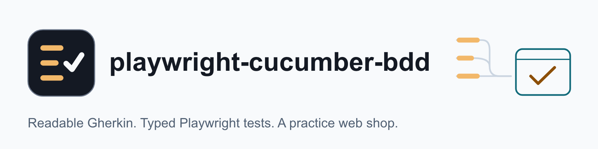
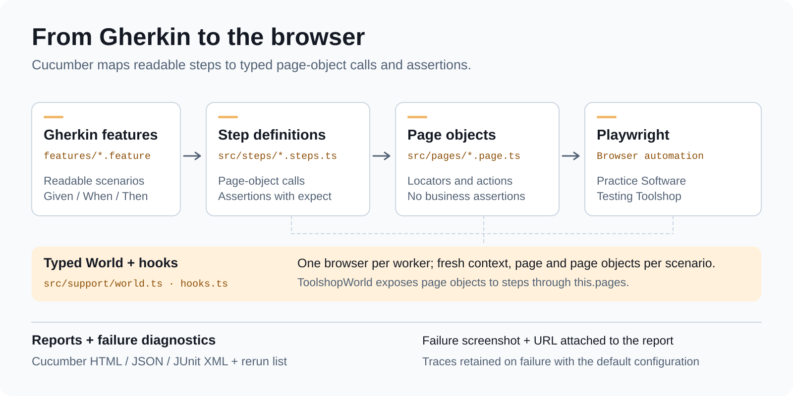
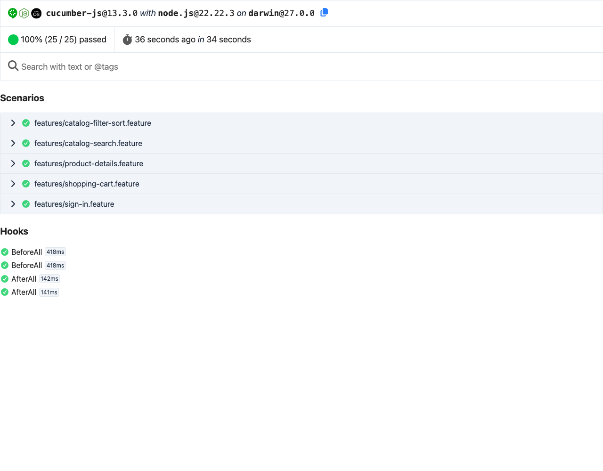

<div align="center">

<picture>
  <source media="(prefers-color-scheme: dark)" srcset="docs/assets/banner-dark.png">
  <source media="(prefers-color-scheme: light)" srcset="docs/assets/banner-light.png">
  
</picture>

### Behaviour-driven end-to-end tests that a non-engineer can read.

[](https://github.com/lemun/playwright-cucumber-bdd/actions/workflows/ci.yml)
[](package.json)
[](tsconfig.json)
[](LICENSE)

[Quick start](#quick-start) · [How it works](#how-it-works) · [Reports](#reports-and-debugging) · [Configuration](#configuration) · [CI](#continuous-integration) · [Limits](#limits-worth-knowing)

</div>

Behaviour-driven end-to-end tests in strict TypeScript: Gherkin features a non-engineer can read,
backed by [Cucumber.js](https://github.com/cucumber/cucumber-js) and
[Playwright](https://playwright.dev). The tests run against the
[Practice Software Testing Toolshop](https://practicesoftwaretesting.com), a demo web shop built for
learning and practising test automation, with publicly documented demo accounts.

<p align="center">
  <picture>
    <source media="(prefers-color-scheme: dark)" srcset="docs/assets/how-it-works-dark.svg">
    <source media="(prefers-color-scheme: light)" srcset="docs/assets/how-it-works.svg">
    
  </picture>
</p>

## Why this project

A complete, runnable Cucumber + Playwright suite that keeps its layers apart and enforces it.

- **Scenarios a product owner can read and review.** Plain-English Gherkin, one sentence per step.
- **One place for every locator.** Page objects own selectors and actions; steps only describe and
  assert, and ESLint fails the build if they don't.
- **Isolated by default.** Every scenario gets a fresh browser context, so parallel runs share no
  cookies, storage or cart.
- **Failures you can debug.** A screenshot and the page URL in the report, and a trace for every
  failed scenario.
- **A real target.** It runs against a public demo shop built for test practice, so you can try it
  without an application of your own.

## Quick start

Requires Node.js 22 or newer.

```bash
npm ci
npx playwright install chromium
npm test                               # every scenario except @shared-account, 3 workers
open reports/cucumber-report.html      # macOS; use xdg-open on Linux
```

To check the project without a browser or any traffic to the demo site, run the same offline checks
CI runs (typecheck, lint, lint-rule proof, format check and a Gherkin dry run):

```bash
npm run check
```

<p align="center">
  
  <br>
  <sub>Offline checks, no browser: each Gherkin step resolves to exactly one step definition
  (a dry run reports steps as skipped because it does not execute them).
  <a href="docs/assets/offline-checks.mp4">Watch the MP4</a>.</sub>
</p>

## Example

```gherkin
Scenario: Combining a category and a brand narrows the results further
  Given I am browsing the catalog
  When I filter by the category "Pliers"
  And I filter by the brand "MightyCraft Hardware"
  Then the results are exactly:
    | product           |
    | Bolt Cutters      |
    | Long Nose Pliers  |
    | Slip Joint Pliers |
```

The steps behind it live in `src/steps/*.steps.ts` and call page objects through `this.pages`; the
locators live in `src/pages/`. See [How it works](#how-it-works).

## Commands

| Command                                     | What it does                                                                 |
| ------------------------------------------- | ---------------------------------------------------------------------------- |
| `npm test`                                  | Runs every scenario except `@shared-account` in parallel, writes the reports |
| `npm run test:smoke`                        | Runs only scenarios tagged `@smoke` (still without `@shared-account`)        |
| `npm run test:shared-account`               | Runs the demo-account sign-ins, one at a time (see below)                    |
| `npm test -- --tags "@cart and not @smoke"` | Any [tag expression](https://cucumber.io/docs/cucumber/api/#tag-expressions) |
| `npm run test:headed`                       | One worker with a visible browser, for watching a run                        |
| `npm run test:rerun`                        | Re-runs only the scenarios listed in `reports/@rerun.txt` by the last run    |
| `npm run test:dry`                          | Checks that every Gherkin step has exactly one step definition, no browser   |
| `npm run report:summary`                    | Prints the last JSON report as a Markdown table                              |
| `npm run lint:rules`                        | Proves the step-file lint rules fire, using `test/lint-fixtures/`            |
| `npm run check`                             | Typecheck, lint, lint-rule proof, format check and dry run (what CI runs)    |
| `npm run format`                            | Formats the code with Prettier                                               |

## How it works

Cucumber reads the features and matches each sentence to a step definition. Steps call page objects
and assert with `expect`; page objects own the locators and actions and talk to Playwright.

Around that core:

| File                             | Role                                                                                |
| -------------------------------- | ----------------------------------------------------------------------------------- |
| `src/support/world.ts`           | `ToolshopWorld`: per-scenario browser context, page and page objects (`this.pages`) |
| `src/support/hooks.ts`           | Launches one browser per worker; on failure attaches a screenshot and saves a trace |
| `src/support/parameter-types.ts` | `{sortOrder}`: turns "from the lowest to the highest price" into a typed value      |
| `src/support/expect.ts`          | Playwright's web-first `expect`, with the project timeout                           |
| `src/pages/index.ts`             | `createPages()`: the list of page objects a scenario can use                        |
| `src/data/demo-users.ts`         | The Toolshop's published demo customers                                             |
| `src/config.ts`                  | Settings from environment variables, validated, with defaults                       |
| `cucumber.js`                    | Profiles: `default`, `sharedAccount`, `rerun`, `dry`                                |
| `scripts/report-summary.ts`      | JSON report to Markdown, used for the CI job summary                                |

### Rules the code follows

1. **Steps describe, page objects act.** A step never builds a selector or calls Playwright. Steps
   import `expect` from `support/expect.ts`. In `src/steps/`, ESLint rejects:
   - `@playwright/test` imports and `this.page`;
   - locator actions on any member chain (`click`, `fill`, `press`, `check`, `selectOption`,
     `hover`, `type` and the rest);
   - page scripting and capture (`evaluate`, `evaluateAll`, `evaluateHandle`, `screenshot`);
   - explicit waits (`waitFor`);
   - selector builders (`locator`, `getByRole`, ...) and `.page()`.

   Steps may still pass a page object's locator to `expect`.
   `test/lint-fixtures/steps/forbidden.steps.ts` holds one violation per case, and
   `npm run lint:rules` fails if any of them is not reported.

2. **Page objects don't judge.** They return locators and data (`visibleProductNames()`,
   `cart.lines()`); the step decides what is correct, so one page object serves many scenarios.
3. **Every scenario starts clean.** A new browser context per scenario means no shared cookies,
   storage or cart, which is what makes parallel runs safe.
4. **Locators follow the app's test hooks.** The Toolshop marks elements with `data-test`, so
   `getByTestId()` is pointed at that attribute. Roles and labels are used where they exist.
5. **Be a good citizen on a shared demo.** Failed sign-ins use addresses with no account, because
   three wrong passwords would lock a demo customer for everyone using the site. Scenarios that
   sign in to a shared demo account are tagged `@shared-account` and only run on purpose.

### Adding a scenario

1. Write the scenario in `features/`. Run `npm run test:dry`: Cucumber prints a snippet for every
   step it cannot match.
2. Paste the snippets into the matching `src/steps/*.steps.ts` file and implement them with page
   objects from `this.pages`.
3. If the page object lacks a locator or action, add it to `src/pages/`. A new page object goes in
   `createPages()` in `src/pages/index.ts`.

### Using this on your own site

The framework (World, hooks, config, page-object base, lint rules, reports) is generic. The Toolshop
parts are the features, page objects, steps and data.

1. Set `BASE_URL` to your site (see [Configuration](#configuration)).
2. Check the test-id attribute. `src/support/hooks.ts` points `getByTestId()` at `data-test`, which is
   what the Toolshop uses. Change it to your app's attribute (often `data-testid`), or remove the line
   to use Playwright's default.
3. Replace `features/`, `src/pages/`, `src/steps/` and `src/data/` with your own, and update
   `createPages()` in `src/pages/index.ts`.
4. Keep `src/pages/base.page.ts`, `src/support/` and the lint rules. If you have no shared
   accounts, delete the `@shared-account` tag, its profile in `cucumber.js` and the matching npm script.
5. Run `npm run test:dry` until every step has exactly one definition, then `npm test`.

## Features

- **Readable features** covering search, filters, sorting, product details, the cart and sign-in, with
  scenario outlines, data tables, a background per feature and a custom parameter type (`{sortOrder}`).
- **A typed World** that works like Playwright Test fixtures: one browser per worker, and a fresh
  browser context, page and set of page objects for every scenario.
- **Page objects** that own every locator and action. Step definitions only call page objects and
  assert, and ESLint enforces it (see [Rules the code follows](#rules-the-code-follows)).
- **No sleeps**: actions wait for the app's own state (the result grid reports `search_completed`,
  `filter_completed`, `sorting_completed`) or for a visible outcome such as the cart badge.
- **Debuggable failures**: a full-page screenshot and the page URL are attached to the HTML report,
  and a Playwright trace is kept for every failed scenario.
- **Parallel runs, tags and reruns**: three workers by default, `@smoke` / `@regression` tags, and a
  rerun profile that replays only the scenarios that failed.
- **Reports** as Cucumber HTML, JSON and JUnit XML, plus a Markdown summary for CI.
- **Tooling**: `tsc` in strict mode, typescript-eslint (strict, type-checked), Prettier, and
  GitHub Actions: offline checks on every push, the live suite only when started by hand.

## Project structure

```text
features/                  Gherkin features: search, filters, sorting, product details, cart, sign-in
src/
  steps/                   step definitions (*.steps.ts): call page objects and assert
  pages/                   page objects (*.page.ts), base page and components
  support/                 World, hooks, parameter types, expect
  data/                    the Toolshop's published demo customers
  config.ts                settings from environment variables, validated, with defaults
scripts/                   report summary and the step lint-rule proof
test/lint-fixtures/        one forbidden pattern per case, checked by `npm run lint:rules`
docs/                      sample run, sample report screenshot, README assets
cucumber.js                profiles: default, sharedAccount, rerun, dry
.github/workflows/         ci.yml (offline checks) and live-e2e.yml (manual live suite)
```

## Reports and debugging

After `npm test`, the `reports/` folder contains:

| Path                      | Contents                                                                                   |
| ------------------------- | ------------------------------------------------------------------------------------------ |
| `cucumber-report.html`    | Interactive report with screenshots attached to failures                                   |
| `cucumber-report.json`    | Cucumber JSON, for other tools and `report:summary`                                        |
| `cucumber-report.xml`     | JUnit XML, for CI test dashboards                                                          |
| `@rerun.txt`              | The failed scenarios, read by `npm run test:rerun`                                         |
| `screenshots/`, `traces/` | Failure artifacts. Open a trace with `npx playwright show-trace reports/traces/<name>.zip` |

A summary of a real run is in [docs/sample-run.md](docs/sample-run.md), and
[docs/sample-report.png](docs/sample-report.png) shows the HTML report.

<p align="center">
  
  <br>
  <sub>The Cucumber HTML report from the sample run.</sub>
</p>

## Configuration

All settings are optional environment variables.

| Variable         | Default                               | Meaning                            |
| ---------------- | ------------------------------------- | ---------------------------------- |
| `BASE_URL`       | `https://practicesoftwaretesting.com` | Site under test                    |
| `BROWSER`        | `chromium`                            | `chromium`, `firefox` or `webkit`  |
| `HEADLESS`       | `true`                                | `false` shows the browser          |
| `WORKERS`        | `3`                                   | Parallel workers for `npm test`    |
| `TRACE`          | `retain-on-failure`                   | `off`, `on` or `retain-on-failure` |
| `ACTION_TIMEOUT` | `15000`                               | Max ms for one action or assertion |
| `STEP_TIMEOUT`   | `60000`                               | Max ms for one step                |

Firefox and WebKit need `npx playwright install firefox webkit` first.

## Shared demo accounts

The sign-in scenarios that use the Toolshop's published demo customers are tagged
`@shared-account`. Those accounts are shared with everyone who practises on the site, so the
default run (`npm test`, `npm run test:smoke`) leaves them out. Run them deliberately, and the
`sharedAccount` profile runs them one at a time:

```bash
npm run test:shared-account
```

## Continuous integration

- **`.github/workflows/ci.yml`** runs on every push to `main` and every pull request: typecheck,
  lint, the lint-rule proof, format check and a Gherkin dry run. No browser and no traffic to the
  demo site.
- **`.github/workflows/live-e2e.yml`** runs the live suite, then one rerun of failed scenarios,
  and uploads `reports/`. It has no push, pull request or schedule trigger: it targets a shared
  public demo, so it only runs when started by hand, from the Actions tab or with
  `gh workflow run live-e2e.yml -f suite=default` (or `-f suite=shared-account`). Only one live
  run is allowed at a time.
- Cloudflare in front of the Toolshop may answer GitHub-hosted runners with a "Verify you
  are human" challenge (HTTP 403, `cf-mitigated: challenge`), in which case every scenario stops on the
  challenge page. The workflow checks for this first and stops with a clear error. To run
  the live suite in Actions, pass a self-hosted runner label as the `runner` input; otherwise run
  it locally.

## Contributing

Issues and pull requests are welcome. Before opening a pull request, run `npm run check` (what CI
runs) and, for a new scenario, follow [Adding a scenario](#adding-a-scenario). The live suite
targets a shared public demo, so please don't start it from a pull request.

## Limits worth knowing

- The suite tests a live public demo, so a slow or changed site can fail a run.
- The expected product names, prices and totals in the features (for example "Claw Hammer" at
  $11.48) come from the Toolshop's seeded catalog when the features were written. The demo is shared and
  updated by its maintainers, so they may drift; when they do, update the data tables.
- Demo accounts are shared with everyone who practises on the site, and other visitors sometimes
  lock one with wrong passwords. If a sign-in scenario fails with "Account locked", switch it to
  another demo user in `src/data/demo-users.ts`.
- Sorting is checked on the first page of results (nine products), which is what a shopper sees.
- The project is not affiliated with Testsmith, the makers of the Toolshop.

## History

This project was rebuilt in 2026 from an earlier private Cucumber + Playwright project of mine. The
framework was rewritten for current Cucumber and Playwright and pointed at a site made for test
automation. Its public history starts at the rebuild.

## License

[MIT](LICENSE)
